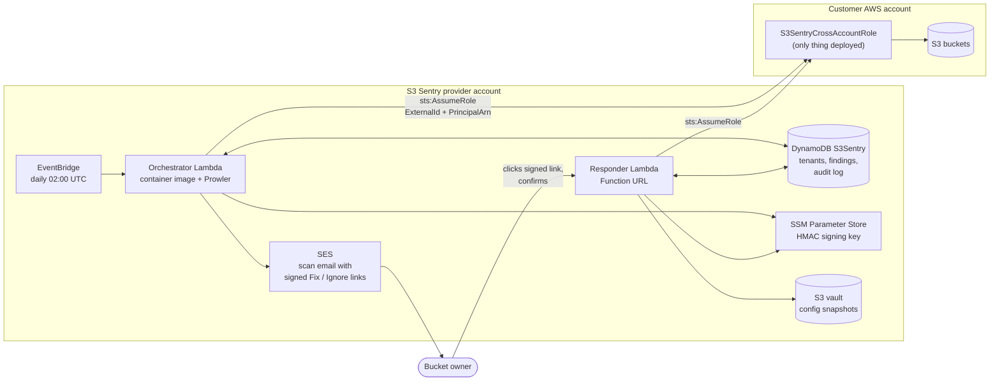
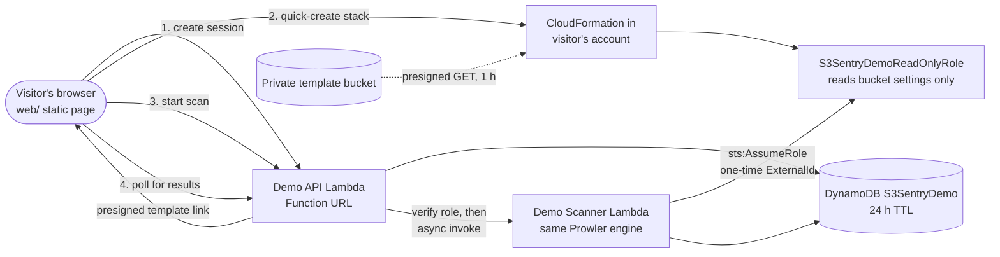

# S3 Sentry

S3 Sentry scans every S3 bucket in an AWS account for public exposure, missing encryption, weak recovery settings and missing logging. Each failure is mapped to NIST CSF 1.1 controls, and it can email the owner a signed one-click fix.

**[Try the live demo →](https://wakimworks.com/judewakim/s3-sentry/)** Run a sample scan in your browser, or scan your own AWS account with a read-only role you delete afterwards.

> **Status: portfolio project in private testing, not a commercial product yet.** Scanning and the public demo work. One-click fixes exist for 2 checks and run in dry-run mode. Rollback is not finished. See [ROADMAP.md](ROADMAP.md) for what's left before it can be sold.

---

## What it checks

14 [Prowler](https://github.com/prowler-cloud/prowler) checks on S3 bucket and account-level S3 configuration:

| Area | Checks |
|---|---|
| Public exposure | Bucket and account Block Public Access, bucket publicly accessible, public list ACL, public write ACL, policy allowing public writes |
| Data protection | ACLs disabled (bucket owner enforced), default encryption, KMS encryption |
| Recovery | Versioning, Object Lock, MFA Delete |
| Visibility | Server access logging, policy requiring HTTPS |

**Not covered yet:** object contents (sensitive data discovery), IAM, other AWS services, runtime threat detection, other clouds. NIST CSF mapping helps prioritize; it is not a HIPAA, PCI DSS or SOC 2 assessment.

Which checks can be fixed automatically, and whether each fix can be undone, is listed in [ROADMAP.md](ROADMAP.md#5-per-check-remediation-plan) and on the demo page.

---

## Architecture

### Scheduled scanning and remediation (provider account)

1. EventBridge starts the orchestrator daily. It reads the tenant list from DynamoDB.
2. For each tenant it assumes the customer's role. The role trusts the provider account only with that tenant's **ExternalId** (stops the confused-deputy attack) **and** only for the two S3 Sentry Lambda roles (`aws:PrincipalArn` condition).
3. Prowler runs the 14 checks with the temporary credentials. Findings are written to DynamoDB under `ACC#<account id>`, never to the customer's account.
4. The owner receives an email. Each finding has Fix and Ignore links signed with HMAC-SHA256: single-use, valid 24 hours, and void once a newer scan runs.
5. The Responder verifies the link, saves the bucket's current settings to the vault, applies the change (dry-run by default) and writes an audit record.

### Public live demo (isolated)

The demo shares the scan engine but nothing else. It has its own table, its own IAM roles and its own read-only visitor role. It sends no email and never joins the daily schedule. Abuse and cost are capped by a 256-bit hashed session ID, per-IP and global daily limits, one scan per session, reserved Lambda concurrency and no retries. Details and the cost estimate are in [demo/README.md](demo/README.md).

---

## Security design

| Concern | Control |
|---|---|
| Confused deputy | Unique ExternalId per tenant (256-bit for demo sessions) |
| Over-broad trust | `aws:PrincipalArn` condition admits only the S3 Sentry Lambda roles. This survives provider-role recreation, unlike a role ARN in `Principal`. |
| Least privilege | Customer role reads S3 config and can write only specific bucket settings (optional via `EnableRemediation=false`). The demo role is read-only and can't read objects. |
| Link tampering and replay | HMAC-SHA256 with constant-time compare, single-use nonce enforced by a DynamoDB conditional write, expiry, scan-sequence binding |
| Injection on action pages | Every field from the (unverified) token is HTML-escaped. Strict CSP, `nosniff`, `no-store` |
| Secrets | HMAC key in SSM `SecureString`; no credentials in the repo; scans use 15-minute STS credentials |
| Public exposure of the demo | Template bucket stays private. Visitors get presigned links, so account-level Block Public Access stays on. |

---

## Repository layout

| Path | Purpose |
|---|---|
| `lambda_handler.py` | Orchestrator: tenant loop, Prowler scan, NIST mapping, SES email |
| `responder.py`, `token_utils.py` | Signed action links and the Fix / Ignore handler |
| `client_onboarding.yaml` | The one IAM role a customer deploys |
| `provider_infrastructure.yaml`, `deploy.ps1` | Provider-account infrastructure and deploy script |
| `generate_launch_url.py`, `onboard_tenant.py` | Manual tenant onboarding |
| `demo/` | Isolated live-demo backend, templates and deploy notes |
| `web/` | Static demo page (no build step, no dependencies) |
| `tests/` | `python -m pytest -q tests/` |
| `orchestrator.py`, `run_orchestrator.bat` | Local runner from Phases 1–2 |
| `JOURNAL.md`, `phase4_plan.md` | Build journal and design notes |

The earlier v1 scanner (SES + HIPAA compliance stack) is preserved at the git tag `legacy-v1-scanner`.

## Tech stack

Python 3.11, Prowler 3.16, AWS Lambda (container images), EventBridge, DynamoDB (single-table), STS, SES, SSM Parameter Store, S3, CloudFormation, Docker.

## Running it

- **Tests:** `pip install moto pytest boto3 && python -m pytest -q tests/`
- **Provider stack:** `.\deploy.ps1` (builds the image, deploys `provider_infrastructure.yaml`, wires the Responder URL). `DRY_RUN` defaults to `true`.
- **Live demo:** see [demo/README.md](demo/README.md).

## Contact

Jude Wakim · [judewakim@wakimworks.com](mailto:judewakim@wakimworks.com) · [GitHub](https://github.com/Judewakim)

## License

MIT
